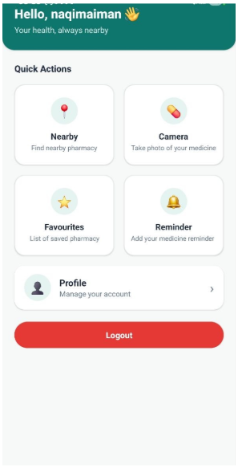
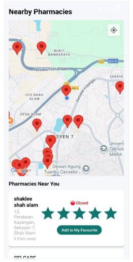
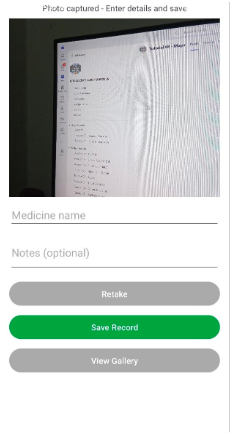
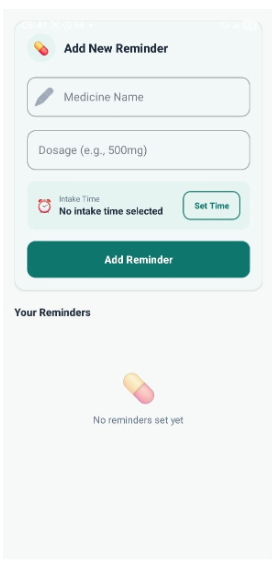

# MediNear 💊
### Nearby Pharmacy Finder

## Overview

MediNear is an Android mobile application designed to help users find nearby pharmacies and manage their medication schedules in one platform.

The application combines location-based services, pharmacy navigation, medicine image capture, and medication reminders to provide a simple and convenient healthcare experience.

## Key Features

- **Nearby Pharmacy Finder** – Detects the user's current location using GPS and displays nearby pharmacies on an interactive Google Maps interface.
- **Navigation Assistance** – Helps users navigate to their selected pharmacy through Google Maps.
- **Medicine Image Capture** – Allows users to capture and save medicine images for personal reference.
- **Medicine Reminder** – Allows users to record medicine names, dosages, and intake times with scheduled local notifications.
- **Favourite Pharmacy** – Allows users to access their saved pharmacy locations easily.

## UI Preview

<table>
  <tr>
    <td align="center" width="50%">
      <strong>Home Screen</strong>  
      
    </td>
    <td align="center" width="50%">
      <strong>Nearby Pharmacy</strong>  
      
    </td>
  </tr>
  <tr>
    <td align="center" width="50%">
      <strong>Camera Screen</strong>  
      
    </td>
    <td align="center" width="50%">
      <strong>Medicine Reminder</strong>  
      
    </td>
  </tr>
  <tr>
    <td align="center" colspan="2">
      <strong>Favourite Pharmacy</strong>  
      
    </td>
  </tr>
</table>

## Technologies Used

- **Android Studio** – Android application development.
- **Java** – Application programming language.
- **Google Maps API** – Displaying nearby pharmacy locations and navigation.
- **GPS Location Services** – Detecting the user's current location.
- **Device Camera** – Capturing medicine images.
- **Local Notifications** – Sending scheduled medicine reminders.

## Mobile Technology Implementation

| Mobile Technology | Implementation |
|---|---|
| GPS | Detects the user's current location. |
| Google Maps API | Displays nearby pharmacies on an interactive map. |
| Camera | Captures medicine images. |
| Local Notifications | Sends medication reminders at scheduled times. |

## Project Information

- **Project Name:** MediNear: Pharmacy Finder
- **Platform:** Android
- **Project Type:** Mobile Application Development
- **Course:** ICT602
- **Category:** Healthcare / Pharmacy Services

